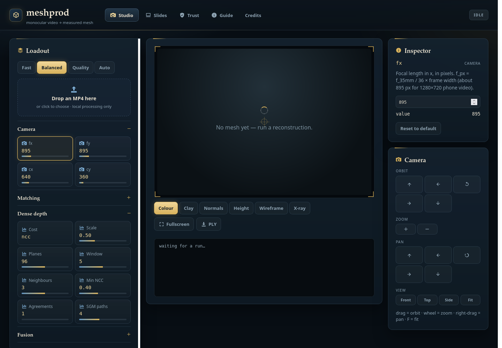
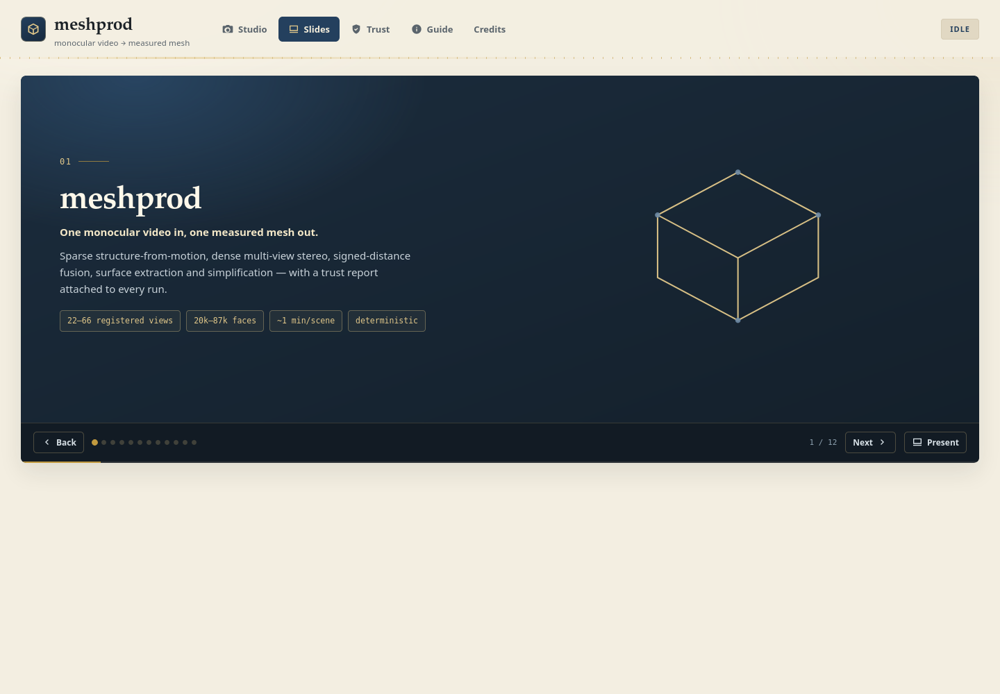

# sfm2mesh

Semester project: turn **one monocular phone video** of an object into a
**simplified, coloured, normal-bearing triangle mesh** (`.ply`).

```
phone MP4 ─► frames ─► sparse SfM ─► dense depth ─► TSDF fusion ─► marching tets ─► mesh ─► .ply
             (done)       (done)        (done)          (done)          (done)         (done)
```

## Status

| Stage | State |
|---|---|
| Video decode (GStreamer) | ✅ |
| SIFT/ORB features + matching + geometric verification | ✅ |
| Sparse reconstruction (`kornia-calib::reconstruct`) | ✅ |
| Sparse PLY (XYZ + RGB + normals) | ✅ |
| Dense depth (plane sweep; NCC, Census or SGM cost) | ✅ |
| Auto-config from measured texture | ✅ |
| Auto-crop (largest voxel cluster) + recentering | ✅ |
| TSDF fusion (confidence- and view-angle-weighted votes) | ✅ |
| Field smoothing + Taubin mesh smoothing | ✅ |
| Marching-tetrahedra mesh extraction | ✅ |
| Quadric-error-metric simplification | ✅ |
| Volumetric hole filling (off by default; see TAI) | ✅ |
| Mesh PLY (vertices, faces, normals, colours) | ✅ |
| Poisson backend comparison (Open3D, screened Poisson) | ✅ `scripts/open3d_poisson.py` |
| Trustworthy-AI (EU ALTAI) assessment | ✅ `docs/tai/ALTAI-assessment.md` |

## Quick start

Requirements: Rust 1.89+, GStreamer 1.20+ with `libav` or `nvcodec` for
HEVC/H.265 phone video.

```bash
cargo build --release

./target/release/sfm2mesh <video.mp4> --output out/mesh.ply \
    --fx 895 --fy 895 --cx 640 --cy 360 \
    --detector sift --n-features 500 --frame-step 10 \
    --geo-verify --sprt
```

Outputs next to `out/mesh.ply`:

| File | Content |
|---|---|
| `mesh.ply` | simplified triangle mesh with normals + vertex colours |
| `mesh_sparse.ply` | sparse SfM point cloud |
| `mesh_cloud.ply` | voxel-downsampled dense point cloud |

Open them in MeshLab, CloudCompare, Blender or Open3D.

## Web UI

```bash
./target/release/sfm2mesh --serve --port 8080   # run from the repo root
# open http://127.0.0.1:8080
```

A game-HUD console (deep navy glass, steel blue, gold): drag-and-drop a video,
watch the nine pipeline stages with **live per-stage progress bars**, orbit the
mesh in a three.js viewer, and tune the pipeline through an **inventory of
slots** — hover any slot and the **inspector** explains it, with the editable
control and reset-to-default.

The viewer has a **camera panel** (orbit, pan, zoom in/out, reset,
front/top/side, fit, auto-rotate), mouse and keyboard control, and a
**fullscreen** viewfinder. Material presets: colour, clay, normals, height,
wireframe, x-ray. The Trust tab carries metric cards, run-history charts
(four seeded captures), EU ALTAI cards, the failure catalogue and config
export. **Guide** explains every setting. **Slides** is an 8-slide,
graphics-first deck (arrow keys, space, dots, `?slide=N` deep links, present
mode). Everything binds to `127.0.0.1`; runs stay in `web_runs/`.




### Poisson comparison backend (Open3D)

```bash
python3 -m venv ~/Dev/tools/venv-o3d
~/Dev/tools/venv-o3d/bin/pip install open3d
~/Dev/tools/venv-o3d/bin/python scripts/open3d_poisson.py \
    out/mesh_oriented.ply out/mesh_poisson.ply --target-faces 20000 \
    --reference out/mesh.ply
```

### Blender demo

```bash
~/Dev/tools/blender-4.5.3-linux-x64/blender -b \
    --python scripts/blender_demo.py -- out/mesh.ply out/demo
```

### Result on `swiss_knife.mp4` (628 frames, 1280×720 HEVC)

| Metric | Value |
|---|---|
| Registered views | 22 / 63 |
| Sparse points / RMSE | 1,175 / 2.086 px |
| Dense depth vs sparse depth | median 4.8 % error |
| Raw mesh | 101,378 faces |
| Final mesh | 86,971 faces, 33 patches, Euler −97 |
| Depth accuracy | median 4.0 %, p90 29.4 % vs sparse points |
| Determinism | byte-identical reruns |

The object is a polished Swiss knife; its specular blade is the main reason the
mesh is open and split into patches. See the TAI report for the failure modes.

### Accuracy pass (measured on the three captures)

| Capture | Depth median / p90 | Patches | Euler |
|---|---|---|---|
| `swiss_knife` (specular) | 4.8 → **4.0 %** / 44.8 → **29.4 %** | 34 → 33 | −104 → **−97** |
| `lip_balm` 18–27 s (white) | 19.0 → **14.8 %** / 77 → 79 % | 41 | −196 |
| `keyboard` 15–25 s (textured) | 6.8 → **4.5 %** / 55.3 → **52.8 %** | 2 → 4 | −36 → **−9** |

Changes behind it: parabolic **sub-pixel WTA**, **8-path SGM**, depth **speckle
filter**, **bilateral mesh smoothing** (feature-preserving), and optional
**needle-triangle removal** (off by default — it opens many edges on noisy
clouds). `--lr-required 2` improves accuracy further but collapses coverage on
these captures, so it stays opt-in.

## Pipeline (short)

1. **Decode** every Nth frame to RGB + gray.
2. **SIFT** keypoints/descriptors per frame (CUDA optional).
3. **Match** within a sliding window: mutual nearest neighbours, Lowe ratio,
   epipolar-RANSAC verification.
4. **Track** matches across frames (`kornia-calib`).
5. **Sparse SfM**: bootstrap, PnP registration (SPRT), triangulation, bundle
   adjustment (up to scale).
6. **Dense depth**: per registered view, sweep inverse-depth planes and keep
   the depth with the best NCC; require agreement from `--lr-required`
   neighbours.
7. **TSDF**: weighted "in front / behind" votes (confidence × view angle) into
   a signed distance field; optional box-filter smoothing.
8. **Mesh**: marching tetrahedra, drop small patches, Taubin smoothing,
   quadric-error-metric simplification.
9. **Attributes**: normals from the TSDF gradient, colours by projecting each
   vertex into the source frames.

`docs/pipeline.md` explains the theory of every stage; `docs/PROCESS.md` is
the full end-to-end process with research citations and the iteration history;
`docs/preset-matrix.md` measures the four presets; `docs/upstream-kornia-issues.md`
tracks work that belongs in kornia-rs.

## CLI (main flags)

| Flag | Meaning |
|---|---|
| `--fx/--fy/--cx/--cy` | pinhole intrinsics in pixels (required) |
| `--estimate-focal <m>` | measure the focal length from a printed Tag36h11 tag of this edge length |
| `--scale-tag <m>` | anchor metric scale from an in-scene Tag36h11 of this edge length (default: up-to-scale) |
| `--calibrate-only` | print the calibration estimate as JSON and exit |
| `--cache-dir <dir>` / `--no-cache` | sparse-stage cache location (default `.meshprod-cache`) / disable it |
| `--detector orb\|sift` | feature detector |
| `--frame-step N` | keep every Nth frame (10 works well for orbit clips) |
| `--geo-verify` | RANSAC epipolar verification |
| `--sprt` | SPRT early rejection during PnP |
| `--sparse-only` | stop after the sparse cloud |
| `--remove-plane` | RANSAC-remove the dominant plane (table/floor) before fusion |
| `--isolate-object` | keep only the orbit-centered object (central + well-supported sparse points) before fusion |
| `--dense-scale` | depth-map resolution relative to source (0.5 default) |
| `--dense-planes` / `--dense-neighbors` / `--ncc-min` | plane-sweep quality knobs |
| `--cost ncc\|census\|sgm` | photometric cost (SGM regularizes low-texture regions) |
| `--sgm-paths` | cardinal SGM paths (default 4) |
| `--auto-config` | derive cost/window/NCC/planes and mesh budget from frame texture |
| `--auto-crop` | keep only the largest 26-connected voxel cluster |
| `--recenter` | translate outputs so their centre is the origin |
| `--serve` / `--port` | local web UI (default port 8080) |
| `--needle-aspect` | drop long/thin triangles above this edge ratio (0 = off) |
| `--bilateral-iterations` | feature-preserving smoothing after Taubin |
| `--voxel-resolution` / `--trunc-voxels` | TSDF resolution and band width |
| `--lr-required` | neighbours that must agree on a depth (default 1) |
| `--volume-smoothing` | TSDF box-filter iterations before meshing (default 2) |
| `--smooth-iterations` | Taubin smoothing iterations (default 8) |
| `--hole-fill-iterations` | TSDF diffusion hole filling (default 0; risky) |
| `--target-faces` | simplify the mesh to this budget (0 = keep) |
| `--min-component-faces` | drop patches smaller than this (0 = keep) |

Intrinsics from a phone: `f_px = f_35mm / 36 * frame_width`, principal point at
the image centre. Portrait clips are often decoded *unrotated* — use the
intrinsics of the decoded frame.

## Sparse-stage cache and calibration

Decoded frames and multi-view tracks are cached on disk. Re-running with only
dense/mesh changes skips decode, matching and tracking: on an 11 s clip, 43 s
becomes 13 s. `--frame-step` keys the frames entry; the feature/matching knobs
key the tracks entry; `--no-cache` disables both. The web UI caches under
`web_runs/cache`.

`--estimate-focal <tag-size-m>` measures the focal length instead of guessing
it: Tag36h11 detection (`kornia-apriltag`) feeds `kornia_calib::estimate_focal`,
and the median over sampled frames is used (the spread is printed). The web
UI's **Calibrate** button runs the same pass and fills `fx/fy/cx/cy`.
Calibration removes the single largest error source on phone captures: a
guessed focal.

## Layout

```
src/video.rs          decode MP4 → RGB + gray frames
src/features.rs       ORB / SIFT extraction (CPU + CUDA SIFT)
src/matching.rs       descriptor matching, ratio test, epipolar RANSAC
src/reconstruction.rs thin wrapper over kornia-calib::reconstruct
src/dense.rs          plane-sweep dense depth + dense cloud
src/tsdf.rs           signed-distance fusion + trilinear sampling
src/mesh.rs           marching tetrahedra, normals, colours, patch cleanup
src/simplify.rs       quadric-error-metric edge collapse
src/mesh_ply.rs       binary mesh PLY writer
src/server.rs         local web UI backend (axum) for --serve
web/                  bone-white / army-blue UI (vanilla JS + vendored three.js)
src/ply_writer.rs     binary point-cloud PLY writer
docs/pipeline.md      how every stage works (start here)
docs/tai/             EU ALTAI trustworthiness assessment
scripts/              reproducibility check for the TAI experiments
```

## Dependency note

Dependencies point at the **`semproj/sfm2mesh` branch** of
`https://github.com/AdarshGuptaa/kornia-rs` — a fork that also carries the SFM
work from PR #1136. The branch is pinned on purpose: this project is built
against a known kornia API.

For fast local iteration against a checkout, add an uncommitted `[patch]`
(builds break if a committed patch path does not exist):

```toml
[patch."https://github.com/AdarshGuptaa/kornia-rs.git"]
kornia-3d      = { path = "../kornia-rs-semproj/crates/kornia-3d" }
kornia-algebra = { path = "../kornia-rs-semproj/crates/kornia-algebra" }
kornia-calib   = { path = "../kornia-rs-semproj/crates/kornia-calib" }
kornia-image   = { path = "../kornia-rs-semproj/crates/kornia-image" }
kornia-imgproc = { path = "../kornia-rs-semproj/crates/kornia-imgproc" }
kornia-io      = { path = "../kornia-rs-semproj/crates/kornia-io" }
```

## Named failures and trust metrics

Every failure exits non-zero with a **stable code, a description and actionable
hints**, writes `<output>_error.json`, and is rendered as a banner in the web
UI (the Trust tab also lists the full catalogue):

| Code | Meaning |
|---|---|
| `invalid-args` / `missing-intrinsics` | rejected before the pipeline |
| `video-decode` / `not-enough-frames` | no usable frames |
| `bootstrap-failed` / `low-registration` | SfM could not anchor (<10 % views) |
| `no-depth-maps` / `empty-cloud` | dense stage produced nothing |
| `empty-mesh` / `mesh-pruned` | TSDF or cleanup removed the surface |
| `cuda-unavailable` / `processing-error` / `io-error` | environment failures |

A successful run writes `<output>_report.json` with the **metric pack**:

- `stats` — views, RMSE, depth error (median/p90), depth maps, raw/final faces, cost, texture
- `mesh_quality` — closed, Euler, patches, boundary-edge ratio, degenerate faces, needle fraction
- `provenance` — video SHA-256, exact CLI args, version (a run is reproducible)
- `resources` — elapsed seconds, peak RSS
- `self_assessment` — heuristic confidence (0–1) and verdict from depth error, coverage and closedness

`scripts/tai_metrics.sh <video>` runs the **robustness suite** (baseline, 360p,
blur, noise, frame drop) and prints a comparison table from the reports.

## Deploying on Linux / Windows

The CPU pipeline is pure Rust. The only system dependency is **GStreamer 1.20+**
(and its dev files to build). Ready-made setup:

```bash
# Linux (Debian/Ubuntu; adapt for dnf)
scripts/setup_linux.sh

# Windows (elevated PowerShell; installs GStreamer devel + runtime MSIs)
powershell -ExecutionPolicy Bypass -File scripts\setup_windows.ps1
```

CI runs fmt, clippy, tests and a release build on **ubuntu-latest and
windows-latest** (`.github/workflows/ci.yml`), so portability is verified, not
assumed. Determinism is guaranteed **per platform/architecture**: repeated runs
on the same machine are byte-identical, but kornia dispatches different SIMD
kernels across architectures and the last bits may differ.

## License

MIT — see `LICENSE`.

## Limitations & known issues (audited)

Every item below was observed in a measured run; numbers are from
`docs/tai/ALTAI-assessment.md`.

### Capture-side (data-bound, the usual cause of a bad mesh)

1. **Non-rigid scene.** SfM assumes a static rigid world. On `lip_balm.mp4`
   only 3/82 views registered while the object was being handled; the static
   segment registered 66/68. Never move or rotate the object by hand.
2. **Panning without parallax.** Translation-free camera movement cannot
   triangulate. `keyboard.mp4` registered 16/228 views for the whole clip (all
   in the last ~3 s); the 15–25 s orbit segment registered 63/101. Use the
   `registered source frames` log to find the usable seconds.
3. **Specular surfaces.** Polished metal breaks photo-consistency: the knife
   (22/63 views) never produced a closed mesh (18–42 open patches) and Poisson
   could not repair it. Fix physically: matte spray, diffuse light.
4. **Textureless surfaces.** NCC/Census need intensity variation. The white
   tube and plain red table gave 16.8 % (NCC), 20.5 % (Census) and 19.0 %
   (SGM) median depth error, with 68/61/43 patches. SGM helps the tail and
   fragmentation but cannot invent signal.
5. **Background dominance.** The support surface is reconstructed as well as
   the object. `--remove-plane` deleted 2.1–5.4 M tabletop points on the knife
   and keyboard, focusing the volume.
6. **Partial orbit coverage.** All three clips cover only part of the object,
   so every mesh is open (Euler −36 … −731) and often a one-sided shell
   (keyboard: top deck only). A closed model needs a full 360° orbit plus a
   second elevation.
7. **Small object / low resolution.** 480×854 portrait frames with the object
   filling <1/3 of the frame reduce keypoint and depth quality; 120 fps fast
   motion adds blur.

### Algorithm-side

8. **Up to scale.** No AprilTag anchor is wired, so shape is correct but
   units are arbitrary (`ScaleSource::UpToScale`).
9. **Fronto-parallel sweep bias.** One sweep direction smooths slanted
   surfaces (Gallup et al. 2007 addresses this with multiple directions).
10. **Discrete WTA, no sub-pixel refinement.** Depth is quantised to the
    plane count; SGM is limited to four cardinal paths.
11. **Census is ambiguous on flat regions.** Every comparison ties, the code
    is constant and the cost is zero everywhere, so plain census WTA treats a
    flat tabletop as a perfect match. Auto-config routes low/medium texture to
    SGM, which resolves it by propagation (measured: keyboard 30 → 2 patches).
12. **TSDF holes and honest failure.** Meshing only uses cells whose eight
    corners are observed, which leaves holes at coverage boundaries.
    Volumetric diffusion can fill them but invents surface where no camera
    looked (blobs/sheets), so it ships disabled.
13. **Distortion is ignored by the dense stage.** The sweep is a pure pinhole
    homography; a large fitted distortion prints a warning, not a correction.
14. **No loop closure or global SfM.** `kornia-calib` is incremental; a
    sequence cannot be split and merged, and long captures can drift. Fixing
    this needs kornia-calib changes (parked).
15. **No object segmentation.** `--auto-crop` clusters voxels by 26-connectivity;
    on a noisy cloud the largest cluster can be a sub-region (measured: the
    knife shrank to 6 tiny islands). It is opt-in and needs a clean cloud.
16. **External Poisson is not a fix for bad input.** Screened Poisson on the
    knife cloud produced lumpy blobs (mean NN distance 60 units, not
    watertight). It is kept for clean captures.
17. **Auto-config is heuristic.** Thresholds (0.012 / 0.035 texture, window,
    plane count) were tuned on exactly three clips; it is a starting point,
    not a guarantee. CPU only; SGM runs views sequentially to bound memory.

### Process / trustworthiness

18. **No metric ground truth.** Object dimensions were never compared against
    a ruler or GT mesh (AprilTag anchoring skipped by decision).
19. **Fairness sample is small.** Four objects (specular, textureless, textured
    box, thin plastic stand); no dark, transparent or deformable coverage yet.
20. **Determinism scope.** Byte-identical reruns verified for the default and
    auto-config paths; not every flag combination.
21. **Pinned dependency.** Builds against the `semproj/sfm2mesh` branch of the
    fork (see *Dependency note*), not upstream `main`.

### Troubleshooting

| Symptom | Likely cause | Action |
|---|---|---|
| "need at least two frames" / hangs | old kornia-io EOS behaviour (pinned branch) | use a decodable clip; the pinned code has a 30 s startup timeout |
| <20 % of views registered | panning, moving object, blur | trim to the segment listed by `registered source frames`; smaller `--frame-step` |
| Depth map mostly empty | textureless surface | `--auto-config`, then `--cost sgm`; add physical texture |
| Table/floor in the mesh | background in the volume | `--remove-plane`; frame the object larger |
| Fragmented / spiky mesh | depth noise, specular | SGM, `--volume-smoothing 3`, `--min-component-faces 500`, Taubin |
| Scene suddenly tiny after cropping | `--auto-crop` picked a sub-cluster | drop `--auto-crop` |
| Blobby Poisson output | incomplete or inconsistent input | do not use Poisson; improve the capture |
| Warning about fitted distortion | wide-angle lens | keep distortion small or undistort before capture |
| Few views despite a clean orbit | `cx`/`cy` swapped between a portrait and a landscape clip | pass intrinsics for the decoded frame: `cx = width/2`, `cy = height/2` (the tool now warns) |
| "<80 keypoints per frame" warning | defocus, motion blur or a textureless scene | refocus, add light/texture, get closer |
| Dense depth accurate but sparse coverage | small baselines (very small `--frame-step`) | use step 5–10 on 30 fps clips |

## Roadmap — biggest levers for better meshes

Ordered by expected gain per unit of effort:

1. **Capture protocol** (free, biggest effect): static object, textured/matte
   surface, full 360° + second elevation, diffuse light, locked exposure,
   30 fps, no zoom.
2. **Default `--lr-required 2` for low/medium texture** + sub-pixel WTA
   (parabolic fit) + 8-path SGM: measured accuracy gain on noisy depth.
3. **AprilTag focal + metric scale** using existing kornia APIs
   (`estimate_focal`, `TagObservation`) — enables ruler-checked accuracy.
4. **Object segmentation** (mask video or an ONNX matting/SAM model) to
   replace `--auto-crop`.
5. **Mesh-level completion**: screened Poisson for clean clouds, or
   feature-preserving bilateral smoothing + hole fill for noisy ones.
6. **Loop closure / global SfM** in `kornia-calib` (upstream contribution)
   so long captures stop drifting and segments can be merged.
7. **Learned features** (SuperPoint/LightGlue) and a DUSt3R/MASt3R baseline
   for the TAI comparison table.
8. **Benchmark** on DTU/ETH3D for metric GT accuracy and repeatability.
